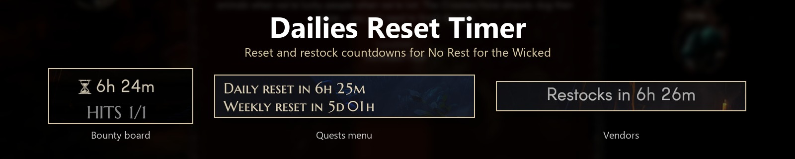
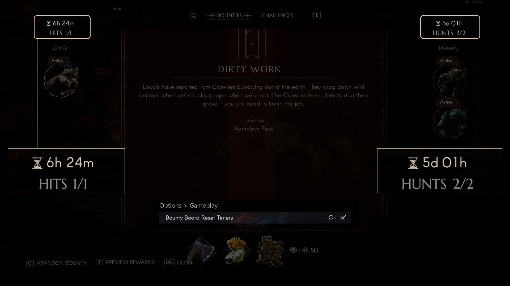
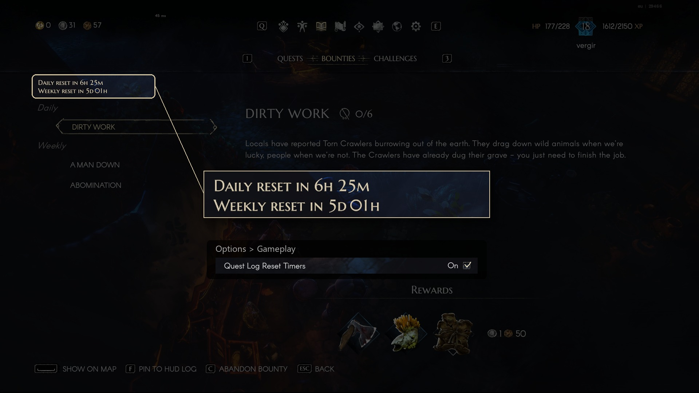
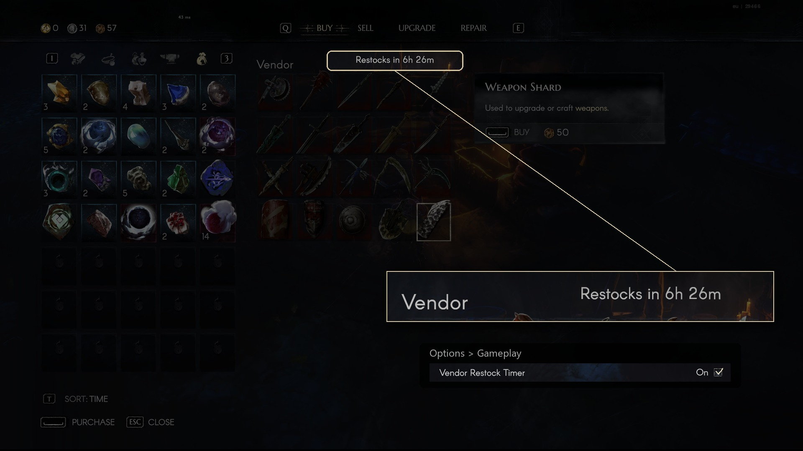
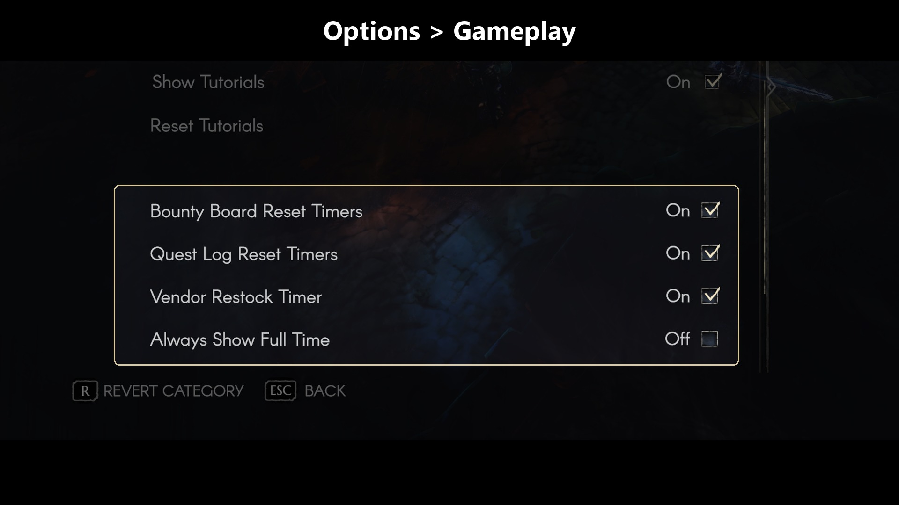
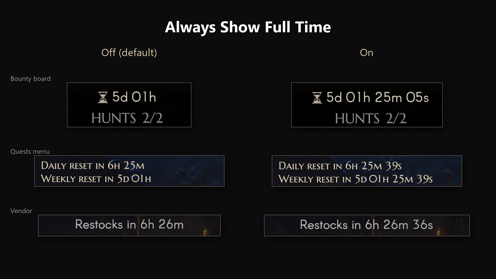

# Dailies Reset Timer

A [MelonLoader](https://github.com/LavaGang/MelonLoader) mod for **No Rest for the Wicked** that shows when daily and
weekly bounties and challenges reset, and when vendors restock.

## Features

* **Bounty board and challenge screens**: an hourglass and a countdown above the Daily and the Weekly column. The game
  has these timers built in but keeps them hidden.
* **Player menu > Quests**: on the Bounties and Challenges tabs, both countdowns above the list.
* **Vendors with limited stock**: "Restocks in ..." above the vendor's items. The game shows no restock time at all.

Countdowns show the two largest units: `5d 08h`, `13h 53m`, then `42m 10s` in the last hour. With
**Always Show Full Time** on, they show every unit down to seconds: `5d 08h 53m 10s`.

The times come from the world's own reset schedule, the same state the game checks before handing out new bounties and
challenges, so they match what actually happens rather than your PC's clock.

Each screen can be switched off with a checkbox at the end of **Options > Gameplay**, where Always Show Full Time is
too.

## Screenshots







## Install

1. Install [MelonLoader](https://github.com/LavaGang/MelonLoader/releases) **0.7.3** or newer into the game
   (`...\steamapps\common\NoRestForTheWicked`) and start the game once.
2. Put `DailiesResetTimer.dll` into the game's `Mods` folder (the
   [release zip](https://github.com/Vergir/NRftW-DailiesResetTimer/releases/latest) already has that layout: extract it
   into the game folder).

### Steam Deck / Linux (Proton)

1. Install MelonLoader into the game folder the same way (copy the files from `MelonLoader.x64.zip`, the Windows build,
   into `~/.local/share/Steam/steamapps/common/NoRestForTheWicked`), and the mod into `Mods`.
2. In Steam, open the game's **Properties > General > Launch Options** and enter:
   ```
   WINEDLLOVERRIDES="version=n,b" %command%
   ```
3. Start the game. On the first start MelonLoader downloads and installs the .NET runtime it needs into the Proton
   prefix by itself, and generates its assemblies; that first start takes a minute or two.

## Settings file

Everything is also stored in `<game>/UserData/MelonPreferences.cfg`, section `[DailiesResetTimer]`:

| Setting | Default | |
|---|---|---|
| `Enabled` | `true` | Master switch. |
| `ShowOnActivityBoard` | `true` | Countdowns on the bounty board and challenge screens. |
| `ShowInQuestLog` | `true` | Countdowns in the Quests menu. |
| `ShowOnVendors` | `true` | Restock countdown on vendors with limited stock. |
| `AlwaysShowFullTime` | `false` | Every unit down to seconds (`5d 08h 53m 10s`) instead of the two largest. |
| `AddSettingsRows` | `true` | Add the checkboxes to Options > Gameplay. |

## Compatibility

* Tested with game build 29466 and MelonLoader 0.7.3 on Windows.
* Read-only: the mod only reads the reset schedule and changes nothing in the game simulation or your save, so it does
  not affect co-op. In someone else's world it shows that world's schedule.
* Game updates can move things around. If the mod stops working after an update, check the MelonLoader log
  (`<game>/MelonLoader/Latest.log`) and open an issue.

## Build

Requires a .NET SDK (6 or newer) and MelonLoader installed in the game (so `MelonLoader/Il2CppAssemblies` exists).

```
dotnet build -c Release
```

The DLL is copied to `<game>/Mods` after every build (`-p:DeployToGame=false` to skip, `-p:GameDir=...` if the game is
installed elsewhere). `pwsh ./package.ps1` builds the release zip into `dist/`.

## How it works

See [docs/internal.md](docs/internal.md).

## License

[MIT](LICENSE)
